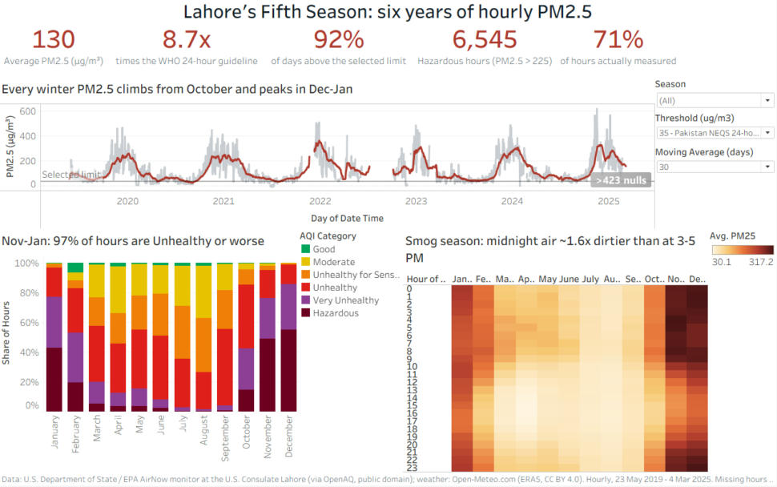
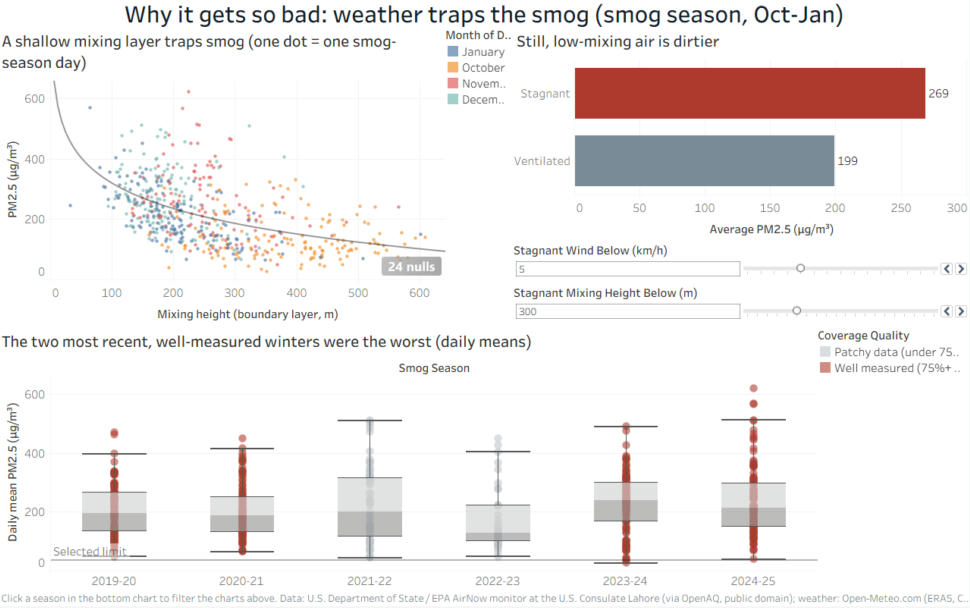
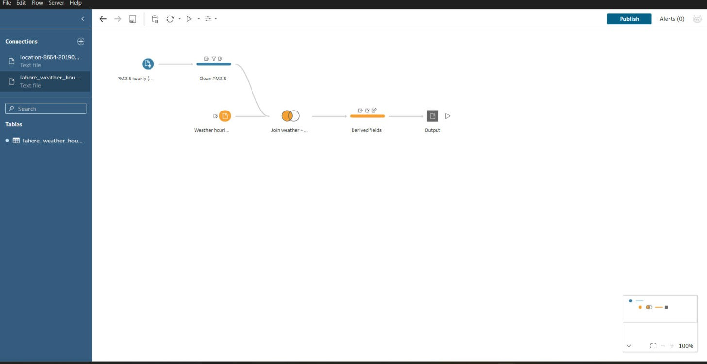

# Lahore Smog

**Six years of Lahore's air, hour by hour (May 2019 to March 2025).**

Every winter, Lahore's air turns so toxic that people call smog the city's *fifth season*. This project takes 44,516 hourly PM2.5 readings from the U.S. Consulate Lahore reference monitor, cleans them in Tableau Prep, joins them to hourly weather, and builds two Tableau dashboards that answer **when** the air is worst, **why** it gets so bad, and **which hours are safest** to be outside.

> **Live dashboard:** [Lahore Smog on Tableau Public](https://public.tableau.com/app/profile/haqiq.azeem.khan/viz/LahoreSmog/WhenandHowBad)



---

## Key findings

| | Finding |
| --- | --- |
| How bad | Average PM2.5 over all measured hours is **130 µg/m³, 8.7× the WHO 24-hour guideline**. Only **1.3%** of hours were "Good"; **67%** were Unhealthy or worse. |
| Limits | **98.8%** of complete days were above the WHO 24-hour guideline and **92%** above Pakistan's own 35 µg/m³ limit. |
| When | December averages **267 µg/m³**, August **46**, almost 6× apart. From November to January, **97%** of hours are Unhealthy or worse and **49%** are Hazardous. |
| Time of day | In smog season the air is worst around **midnight (253)** and cleanest from **3 to 5 PM (154)**, about 1.6× cleaner. School sports and assemblies belong in the early afternoon. |
| Weather | Stagnant hours (wind < 5 km/h, mixing layer < 300 m) average **269 vs 199** µg/m³ in smog season, **35%** dirtier. The shallowest fifth of mixing heights averages **284**, the deepest fifth **149**. |
| Rain | The day after ≥ 5 mm of rain has about **half** the PM2.5 of a day after a dry day in the same month. |
| Trend | Of the four well-measured winters, **2023-24 and 2024-25 were the worst** (means 229 and 236 vs 202 and 206), and their share of Hazardous hours rose from about 34% to 44-51%. |
| Worst day | **14 November 2024**: daily mean **621 µg/m³**, 41× the WHO guideline. |

**What it supports:** start winter controls (kiln and crop-burning bans) by early October; move outdoor school activity to the early afternoon; use a forecast of calm, shallow air as a 1-2 day early warning; track Hazardous hours per winter as a single accountability number.



## Why this matters

- In **November 2024**, Lahore's AQI passed **1,000** and Punjab closed the city's primary schools.
- On **29 October 2026**, Lahore was ranked the **world's most polluted city** again.
- Air pollution is estimated to cut Pakistani life expectancy by **3.9 years**.
- In **March 2025**, the U.S. State Department stopped publishing its embassy and consulate air data. This project keeps a clean, documented record of the six years before the feed went dark.

## Data

| | PM2.5 (measured) | Weather |
| --- | --- | --- |
| Source | U.S. Consulate Lahore monitor (U.S. State Dept. / EPA AirNow), via [OpenAQ](https://docs.openaq.org/docs/accessing-openaq-archive-data) location 8664 | [Open-Meteo Historical Weather API](https://open-meteo.com/en/docs/historical-weather-api) (ERA5) |
| Rows | 44,516 hourly readings in 1,909 daily files | 50,712 hourly rows |
| Period | 23 May 2019 to 4 Mar 2025 | same |
| Licence | U.S. public domain | CC BY 4.0 |

Credits are in [DATA_LICENSES.md](DATA_LICENSES.md); column definitions in [data/data_dictionary.md](data/data_dictionary.md).

## Cleaning (Tableau Prep)



The flow is in [prep/lahore_smog_flow.tfl](prep/lahore_smog_flow.tfl) and writes [data/processed/lahore_smog_clean.csv](data/processed/lahore_smog_clean.csv): one row per hour, 50,712 rows, 15 fields.

| Problem found | How it is handled |
| --- | --- |
| 7,879 readings of `-999` ("no reading") | set to NULL |
| 228 small negatives and 25 exact zeros | set to NULL (below what the monitor can measure) |
| Sensor stuck at exactly 67.0 for 127 hours (31 May to 5 Jun 2024) | set to NULL |
| 17 one-hour spikes > 300 µg/m³ above both neighbours | kept, flagged `Suspect spike` |
| Weather file has two location lines above the header | header row set to 4 |
| Gaps (Jun-Sep 2022 almost all missing; Feb-Mar 2023 about half) | left as gaps; the left join keeps every hour so gaps stay visible |
| Boundary layer height missing Jan-Jun 2024 in the weather source | stagnation flagged `Unknown` |

In total 8,259 of the 44,516 raw readings (18.6%) were invalid, leaving **36,257 usable hours**. The Prep output was checked row by row against an independent Python rebuild of the same rules ([analysis/rebuild_clean.py](analysis/rebuild_clean.py)): **0 mismatches**.

### Derived fields

| Field | Rule |
| --- | --- |
| Season | Smog (Oct-Jan), Spring (Feb-Mar), Pre-monsoon heat (Apr-Jun), Monsoon (Jul-Sep) |
| Smog Season | one label per winter, e.g. Oct 2024 to Jan 2025 = `2024-25` |
| Hour of Day | 0-23, Pakistan time |
| AQI Category | EPA 2024 PM2.5 breakpoints, Good to Hazardous |
| WHO Multiple | PM2.5 ÷ 15 |
| Stagnation Flag | Stagnant when wind < 5 km/h and boundary layer < 300 m |
| Data Status | Valid, Suspect spike or Missing |

## Dashboards

| View | Question | Chart choice |
| --- | --- | --- |
| KPI strip | How bad overall? | big numbers that respond to the Season filter and Threshold parameter |
| Daily trend | When, and is it getting worse? | grey daily mean under a red moving average (7/14/30/60-day parameter), selected limit as a reference line |
| AQI mix by month | How much of the time is unhealthy? | 100% stacked bar in EPA colours, severity order |
| Smog clock | Which hours are safest? | hour × month heatmap, light-to-dark sequential scale |
| Mixing height vs PM2.5 | Does still air trap smog? | one dot per smog-season day, log trend line |
| Stagnant vs ventilated | How much worse is stagnant air? | bar with two sliders that redefine "stagnant" live |
| Smog seasons | Is each winter worse? | box plot of daily means; winters with < 75% data greyed out |

Interactivity: Threshold, Moving Average and two stagnation parameters; a Season filter shared by the KPIs, AQI mix and smog clock; month highlight actions; clicking a winter in the box plot filters the weather charts.

**A forecast was left out on purpose.** With a four-month gap in 2022, one site and a feed that stopped in 2025, an exponential-smoothing forecast would look precise without being reliable.

## Reproduce

```
python scripts/download_data.py                       # raw data into data/raw/
# open prep/lahore_smog_flow.tfl in Tableau Prep and run it
#   (the flow expects the repo at C:\lahore-smog; elsewhere, re-point its two inputs and the output)
pip install cwtwb lxml
python workbook/build/build_workbook.py               # workbook built in code
python workbook/build/finish_workbook.py workbook/build/lahore_smog.twb
python workbook/build/package.py workbook/build/lahore_smog.twb workbook/lahore_smog_dashboard.twbx
python analysis/rebuild_clean.py && python analysis/insights.py   # numbers in analysis/numbers.json
```

## Repository

```
lahore-smog/
├── data/processed/        cleaned dataset (Prep output) + data_dictionary.md
├── prep/                  Tableau Prep flow (.tfl)
├── workbook/              Tableau workbook (.twbx) + build/ scripts
├── analysis/              independent checks and the numbers quoted here
├── screenshots/           Prep and Tableau screenshots
└── scripts/               data download
```

## Limitations

- One monitor is one point in the city, not all of Lahore.
- The public feed stops in March 2025.
- Weather comes from a ~25 km reanalysis grid and shows patterns, not street-level conditions.
- Hourly AQI categories use the 24-hour breakpoints as an approximation; the official AQI uses a 24-hour average.
- Correlation with weather is not causation: emissions are not in the data.

## Licence

Code and project files: [MIT](LICENSE). Data keeps its original licences, listed in [DATA_LICENSES.md](DATA_LICENSES.md).
